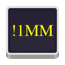
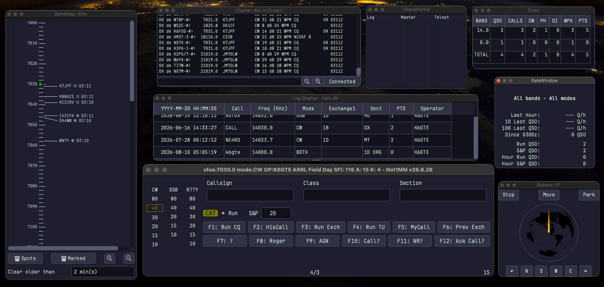

<!-- markdownlint-disable MD001 MD033 MD041 -->
<center>

# Not1MM

 

</center>

 The worlds #1 unfinished contest logger <sup>*According to my daughter Corinna.<sup>

[](https://pypi.org/project/not1mm/)
[](https://www.gnu.org/licenses/gpl-3.0)
[](https://www.python.org/downloads/)
[](https://pypi.org/project/PyQt6/)
[](https://xkcd.com/1695/)
[](https://pepy.tech/projects/not1mm)
[](https://pepy.tech/projects/not1mm)



### The Elephant in the Room

Not1MM's interface is a blatant ripoff of N1MM. It is NOT N1MM and any problem
you have with this software should in no way reflect on their software.

### Not1MM is NOT ment for interoperability with N1MM+

I wake up, take my first sip of coffee and am greeted by a lovely heartfelt [message](TomsAMassiveTwat.md) from Tom Wagner.
So I feel something may need to be clarified. Not1MM is... NOT N1MM neither is it N1MM+ or even N1MMPlus.
They're not ment to work with each other. It does send N1MM packets, but that's for nodered scoreboards, not Tom's beloved program.

You shouldn't bother Tom or his Team. They be cranky...

### The What

Not1MM is, in my opinion, a usable amateur radio, or HAM, contest logger. It's
written in Python 3.11+, and uses Qt6 framework for the graphical interface
and SQLite for the database.

### Target Environment

The primary target for this application is Linux and MacOS. It may be able to run on other
platforms, BSD and Windows. But I don't have a way, or desire, to directly support them.

### The Why

**Currently this exists for my own personal amusement**. I've recently retired
after 35+ years working for 'The Phone Company', GTE -> Verizon -> Frontier.
And being a Gentleman of Leisure, needed something to do in my free time.
I'm a casual contester and could not find any contesting software for Linux that
I wanted to use. There is [Tucnak](http://tucnak.nagano.cz/) which is very robust
and mature. It just wasn't for me.

## Code Maturity & Current Multi Multi Development Focus

Not1MM is, at times, fairly stable. Recently, it would seem that I'm desperately trying to change that. The current focus of development is adding support for [Multi Multi](Multi-Multi.md) contest operations. It is something that I have no practical experience in. So you can expect the same quality of code fit and finish.

## Our Code Contributors ✨

I wish to thank those who've contributed to the project. Below is an automatically
generated, 'cause I'm lazy, list of those who've submitted PR's.

<a href="https://github.com/mbridak/not1mm/graphs/contributors">
  
</a>

## Recent Changes

- [2026-11-06] Merge pull request #735 from DJLax5/fix-voice-samplerate
  - Add audio resampling and play-back at the native sampling rate of the desired output sound devices
- [2026-11-05] Merge pull request #732 from DJLax5/issue-717-band-memory
  - Removed Preference.save in the update band memory
- [2026-11-04] Merge branch 'master' of http://github.com/mbridak/not1mm
  - Merge pull request #725 from DJLax5/issue-719-cq-freq
  - Merge pull request #728 from DJLax5/issue-717-band-memory
  - Merge pull request #727 from DJLax5/issue-722-utc-clock
- [2026-11-01] Band buttons: remember last frequency per band, mode and VFO (#717)
  - Store CQ frequency on F1 Key and Click, adds  switch to S&P on QSY option
- [2026-11-04] Adds a UTC clock to the top right of the main window
- [2026-11-03] Merge pull request #726 from DJLax5/issue-718-spot-dx
  - Merge pull request #731 from df7cb/new-spots-clear-freq
  - Make "new spots clear frequency" configurable
  - Merge pull request #730 from df7cb/contest
  - tci: the CW test expects the wrong command for sending text
  - Cabrillo name of EUHFC is EUHFC
  - tests: add the contest log corpus, its generator and its runner
  - US contests: in-area scoring and the empty section
  - VHF and distance contests: the band and mode multipliers
  - Award, DX and activity contests: the DXCC models and the prefixes
  - European HF contests: the stored exchange, the geographic points and the prefill
  - SAC: match the entities cty.dat actually stores
  - AADX contests: work out the duplicate before re-scoring, and guard the lookups
  - 10-10 contests: read the logged exchange, not the entry field
  - REF contests: the multiplier model and the stragglers
  - ARI contests: scoring, prefixes and the 40-80 Cabrillo name
  - JIDX contests: score only JA-DX contacts, and the Cabrillo category
  - NAQP and the CW activity tests
  - URE (Spain) contests: the exchange, EF0F and the multipliers
  - SSA Manadstest: the multiplier key and a locator crash
  - DARC contests: the DOK and prefix multipliers, and re-scoring duplicates
  - ERAU (Estonia) contests: the ES-only rule and the dupe windows
  - RSGB and UK contests: credit, modes and the multiplier model
  - WIA and VK contests: the dupe windows, the prefixes and the Oceania points
  - IARU contests: multipliers once per band, and the entrant's own zone
  - ARRL contests: contest credit, multipliers and the mode/band tables
  - CQ contests: fix the country, QTH and band multipliers
  - plugin_common: round-trip the station callsign through ADIF
  - ham_utility: add band_mhz_of() to normalise a stored band
  - database: make the period duplicate window half-open
  - plugin_common: read a contact's own time for a windowed dupe rule
  - plugin_common: share the ADIF import and the Cabrillo/EDI export
- [2026-11-01] Merge pull request #724 from DJLax5/issue-715-cabrillo-crash
  - Removed my call to a generic one
  - Merge pull request #711 from rxcomm/na-sprint
  - Fix Cabrillo export crash on QSO without exchange (#715)
  - Make SPOT_DX key action use MainWindow.spot_dx (#718)
- [2026-09-25] This commit adds support for a new contest, the NA Sprint. Rules for the contest are a...
- [2026-10-30] Merge pull request #709 from microphonon/statistics
  - add CTY ZN breakdown
- [2026-10-29] Merge pull request #708 from microphonon/qso_party
- [2026-10-28] fix qso parties
  - @mbridak Fix: Enable socket draining and improve logging format in rigctld_command and...


See [CHANGELOG.md](CHANGELOG.md) for prior changes.

## Installation Flatpak or UV

### Via Flatpak

I'm pretty sure the flatpak works now. Let me know if it doesn't.

Go to the latest [Release](https://github.com/mbridak/not1mm/releases/latest) and grab the flatpak file.

#### Install

```bash
flatpak install --user not1mm.flatpak
```
#### Run it

```bash
flatpak run io.github.mbridak.not1mm 
```

Or find it in your launcher.

### Via uv installer

#### Prerequisites

Not1MM requires:

- PyQt6
- libportaudio2
- libxcb-cursor0 (maybe... Depends on the distro)

#### One liner install
  
```bash
curl -LsSf uvx.sh/not1mm/install.sh | sh
```

For more in depth info, please see the [installation](INSTALL.md) section.

## Documentation

I've nuked 90% of the README.md and moved it to a LaTeX file. So now you can get the [user manual](https://github.com/mbridak/not1mm/releases/latest) as a PDF file. I know some WILL NOT LIKE THIS. Sorry, not sorry.

## Features

A quick feature list, See the user manual for more details.

- 60+ [supported contests](Working_Contests.md)
- Lookup, QRZ and HamQTH
- CAT Control via rigctld, flrig or TCI
- CW Keyer Interface, [SwiftKeyer](https://github.com/mbridak/SwiftKeyer) for MacOS, [pywinkeyer](https://github.com/mbridak/PyWinKeyerSerial) or cwdaemon for Linux 
- Cluster and Bandmap
- Rotator control via rotctld
- [Multi Multi](Multi-Multi.md) (Kinda sketchy, but give it a try)
- N1MM Packet output for nodered
- WSJT-X FT8/FT4/ETC and RTTY via FLDIGI
- ADIF and Cabrillo output.
- And *Other Stuff*

## Known Issues

- Hamlib before 4.6.3 had a problem with sending CW and changing/reading the keying speed.
- wfview ~~before version 2.2~~ has issues with frequency reporting and CW sending.
